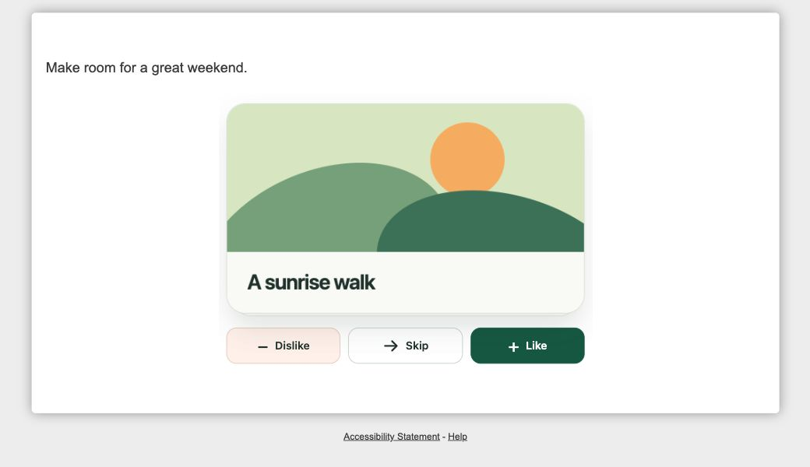

# Decipher swipe cards

Turn a native Decipher radio matrix into swipe cards. Each activity is a row; Dislike, Skip and Like are ordinary columns. Decipher stores and validates the answers.



[Try the single-question demo](https://sw2.decipherinc.com/survey/selfserve/57d/2610176) · [Try two questions on one page](https://sw2.decipherinc.com/survey/selfserve/57d/2610177)

These are isolated testing surveys with synthetic content. The screenshot is from the native respondent page.

## Paste into Decipher

1. Create a new testing survey and open its XML editor.
2. Paste [survey.xml](survey.xml) as the complete survey, save, and preview. All CSS and JavaScript are included; no build, server, external asset hosting or Questra account is needed.
3. Edit the `<title>`, `<comment>` and `<row>` text near the bottom. Keep valid unique labels and the three columns unchanged. Escape XML text such as `&` as `&amp;`.

For an existing survey, copy the two top-level `<style>` blocks inside its `<survey>` **once**, then copy the `<radio>` question wherever needed. Give each copied question a unique label. Leave questions adjacent for one page, or separate them with `<suspend/>`. Do not nest the shared styles inside a question or duplicate them for every component. Preserve your survey's other settings and verify its theme in preview.

## Native answer model

The sample is a required `<radio type="rating" optional="0">` with `ss:questionClassNames="qswipe"`. A row such as `r1` becomes one card; the columns remain fixed:

| Action | Column | Exported value | Observed native input value |
| --- | --- | --- | --- |
| Dislike / swipe left | `c1` | `1` | `0` |
| Skip | `c2` | `2` | `1` |
| Like / swipe right | `c3` | `3` | `2` |

For example, `QSwipe` + `r1` exports as `QSwiper1`. **Skip is a selected answer (`2`), never an unanswered row.** JavaScript clicks the existing native radio input and never creates a parallel answer store or hardcodes generated field names.

Forsta documents [single-select matrices grouped by rows](https://forstasurveys.zendesk.com/hc/en-us/articles/4409476975899-Single-Select-Question-XML). The values above were also checked against native response exports.

## Shared code and interaction

The survey-level `respview.client.css` and `respview.client.js` hooks append the shared code after Decipher's defaults. `wrap="ready"` runs initialization when the page is ready. Decipher renders those definitions once on each respondent page; one initializer then creates independent instances for the page's `.question.qswipe` elements. These are supported [XML style hooks](https://forstasurveys.zendesk.com/hc/en-us/articles/4409461374491-XML-Style-System), with official examples for [JavaScript](https://forstasurveys.zendesk.com/hc/en-us/articles/4409461346587-Including-JavaScript-in-a-Survey) and [CSS](https://forstasurveys.zendesk.com/hc/en-us/articles/4409461345307-Including-CSS-in-a-Survey). Keep the escaped `\@media` rules when editing the XML.

Each instance discovers native radio groups, row legends and column-header associations from the rendered matrix. It hides the matrix only after setup succeeds. Missing JavaScript or unsupported markup leaves the native question usable. Component CSS is scoped to `qswipe` and explicitly marked form/page elements.

Drag horizontally to move, rotate and fade a card. Crossing the threshold commits the direction; releasing early springs it back. Buttons use the same locked transition, and the next card peeks from behind. On a focused card, Left Arrow dislikes, Right Arrow likes, and S skips. The layout adapts to narrow screens; pointer events support touch while vertical scrolling remains available. Reduced-motion preferences suppress the transitions. Accessible instructions and card progress are announced without adding visible teaching controls.

After a deck's final animation it disappears. If every visible question on the page is an initialized, completed swipe question, a form-level coordinator clicks Decipher's existing Continue button once. It waits for **all** decks on a shared page. If any other visible question type is present, Continue stays visible for manual submission and native validation. The code never calls `form.submit()` or repeatedly retries an automatic submission.

On restored completed answers, validation recovery, browser-cache re-entry, or a stalled submission, the native matrix and Continue become available for review. Answers are saved when Decipher submits the page; this does not add autosave for unfinished pages. The intentionally minimal demo disables native Back and has no Undo/review navigation. Its native fallback retains normal editable radio fields.

## Reuse with Questra fine-tuning templates

Import [questra-template.json](questra-template.json) from Questra's Fine tuning page. The export contains a base template with the shared hooks, a `main` content slot, and one XML-output component named `SwipeCards`. The component itself contains only the native question, so generating multiple instances does not duplicate the scripts or styles.

The component accepts `label`, `title`, `instructions`, and `rows` (objects with `label` and `text`). For example:

```json
{
  "label": "QBreaks",
  "title": "Make time for a little break.",
  "instructions": "Choose Dislike, Skip or Like for each idea.",
  "rows": [
    { "label": "r1", "text": "Coffee and a good book" },
    { "label": "r2", "text": "A walk by the river" }
  ]
}
```

Select the imported template when programming a questionnaire. A sample request is: “Create one required swipe-card matrix called QBreaks using SwipeCards. Cards: coffee and a good book; a walk by the river; a board-game evening. Keep Dislike, Skip and Like as the three response columns.” Preview the generated survey and check the exported row values before fielding.

Variability is deliberately limited to plain-text titles, instructions, question labels and 1–20 rows. The three response codes and interaction stay fixed. The current schema checks types and required properties; authors must also check identifier validity, uniqueness and row count. Images, rich text, conditional rows, randomization, exclusive choices, other widgets, alternative themes and translations need separate implementation and native verification.

## Verification and limits

The shared-hook revision was checked in native Decipher testing surveys on desktop Chrome:

- Two questions on one page: one shared CSS definition, one shared JavaScript definition, two independent decks. Finishing the first left the second unanswered. A final double-click resulted in one completed response; exports were `QIdeasr1=1`, `QIdeasr2=2`, `QBreaksr1=3`, `QBreaksr2=2`.
- Two pages: one shared definition per page; reload on page two retained the submitted first page. Final exports were `2,3` and `1,3` respectively.
- Mixed required-text page: finishing the cards did not submit. Manual Continue showed Decipher's required-answer error. After filling the text, the exported card values remained `3,2`.
- Buttons and keyboard paths passed. Native compilation and source read-back passed for the single-question, two-question and alternate-content demos. Questra transfer validation, component rendering, XML escaping, base-template compilation and a saved-template export round trip passed.

Earlier checks covered desktop dragging, below-threshold snap-back, required matrix rows, JavaScript fallback, validation recovery, and mobile-width layout/buttons. Touch-drag automation was blocked by the browser tool, so a physical phone gesture check remains outstanding. Safari, Firefox, a screen reader and reduced-motion emulation have not been verified. A prior AI test generated a working native survey but its final automated assessment failed; that assessment is not claimed as passed. No product code was changed to bypass it.
