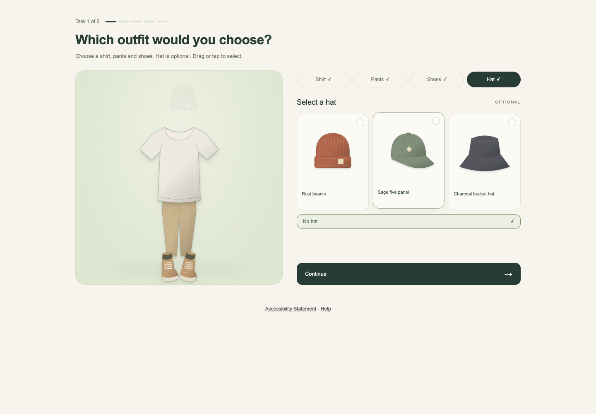

# Outfit selection — Decipher

A native five-task outfit question: choose a shirt, pants and shoes, with an optional hat. Drag an item into the outfit or tap it, then use Continue. Decipher stores and validates the answers.

[Try the live component](https://sw2.decipherinc.com/survey/selfserve/57d/2610179). This is an isolated testing survey with synthetic content; the screenshot is from its respondent page.

## Use in Decipher

1. Create a testing survey. Upload [outfit-design-v2.dat](outfit-design-v2.dat) as a **system file**.
2. Upload the 24 SVG files in [assets](assets/) as **static files**, preserving their filenames.
3. Paste [survey.xml](survey.xml) into the XML editor, save, and preview. It includes the shared CSS/JavaScript and native logic. No external image host or build is required.

The survey-level `respview.client.css` and `respview.client.js` hooks are defined once and reused on every task. Keep `autosave="1"` and the brief initialization page: its native submission persists the assigned design before task one. The visual Continue control invokes Decipher's original submission button; it does not bypass native validation.

## Genuine design file and response schema

The `.dat` is a headered TSV with columns `Version`, `Task`, `Concept`, `Shirt`, `Pants`, `Shoes`, `Hat`. It contains 12 versions × 5 tasks × 3 concept slots. Each attribute level is an integer from 1–6. Each version has five distinct offered subsets per category.

The classic `setupDCMFile` loader reads the survey system file and keys rows as `v{version}_t{task}_c{concept}`. Its three concept slots supply the offered menu for each task; respondents choose independently across categories. Native Python selects and retains a version, sets row conditions, and rejects unoffered values. JavaScript does not randomize the design. This uses the classic design-file approach, not the newer `de_dcm.1` whole-concept choice widget.

| Native field | Meaning |
| --- | --- |
| `DesignID`, `DesignVersion` | Immutable design ID and assigned version |
| `Task_1` … `Task_5` | Task number within that version |
| `Offered_shirt_1` … `Offered_hat_5` | Stable offered IDs in design slot order |
| `Shirt_1`, `Pants_1`, `Shoes_1`, `Hat_1` … round 5 | Exported choice codes: 1–6; hat 0 means No hat |

[dataset.json](dataset.json) maps IDs such as `shirt4` to names, codes and static image filenames. Browser radio values are zero-based positions, **not** export codes. Display order is ascending numeric ID; offered fields retain design slot order. [design-manifest.json](design-manifest.json) records the design ID and SHA-256. These are seeded synthetic permutations, not an optimized or statistically validated conjoint design.

Native data persists on page submission. Session storage retains only the current unsubmitted draft and restores IDs only if still offered. Server validation can return Decipher's editable native error form.

## Questra fine-tuning export

Import [questra-template.json](questra-template.json) from Questra's Fine tuning page. It includes:

- [Base template](base-template.xml): shared CSS/JS, dataset, design loader, and a `main` slot.
- [Reusable component](component.template.xml): assignment and five native tasks, without duplicate shared styles/scripts.
- The real design file marked private/system and all 24 SVGs marked public/static, embedded as base64 with content hashes.

Select the imported template when programming and request one `OutfitSelection` component in `main`. Its input schema requires a valid loop `label`; [example-input.json](example-input.json) uses `{"label":"OutfitRounds"}`. Rendering that example with the base template reproduces `survey.xml` exactly.

This is intentionally a **single-instance, fixed-design example**. The label names the loop; it does not rename the fixed native child fields or create independent DOM instances. Do not insert multiple copies into one survey. To change the wording, inventory or design, edit the base/component source and corresponding files together, then recompile and verify native exports. The current schema checks types/required fields; also validate identifiers and uniqueness before fielding. Replacing image URLs does not require changing the drag/snap code; use a consistent transparent 300×320 aspect ratio. The supplied SVG illustrations are original synthetic artwork.

## Documentation and verification

Forsta documents the [XML style system](https://forstasurveys.zendesk.com/hc/en-us/articles/4409461374491-XML-Style-System), [DCM design files and widget limitations](https://forstasurveys.zendesk.com/hc/en-us/articles/33312867740699-Customizing-the-DCM-Conjoint-Element), and [native autosave](https://forstasurveys.zendesk.com/hc/en-us/articles/4409461295003-Attributes-for-Field-Settings). The classic loader and TSV contract were also checked against an existing local working implementation before development.

The cleaned live survey passed all five tasks, refreshes in tasks 1 and 3, exact matching of all 20 choices/offered sets to the native export, no-hat and selected-hat cases, desktop dragging, and rapid choice/Continue input. Each task submitted once; completion refresh left one completed record. Desktop and mobile visuals were inspected. Earlier checks of the unchanged interaction/validation code covered native required errors, unoffered-value rejection, emulated touch dragging, keyboard selection and reduced motion.

The export passed Questra's transfer schema, component renderer and base-template compiler. Its example output and embedded file bytes match the cleaned deployed survey/assets. An actual UI import/AI programming run of this new export has **not** been performed. Physical phones, Safari/Firefox, screen readers, cross-device restoration and interrupted network submission remain untested. No respondent exports or credentials are included here.
