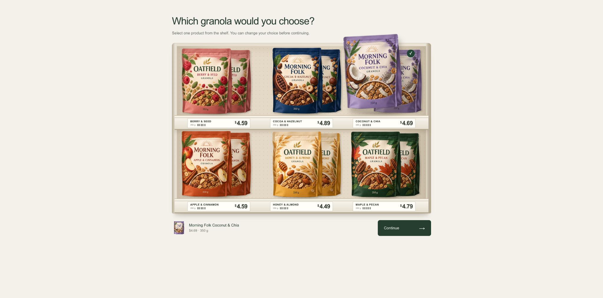

# Shelf testing — Decipher

[Try the native component](https://sw2.decipherinc.com/survey/selfserve/57d/2610187)

Choose one fictional granola from a grocery shelf, change the choice if needed, then Continue. The selected pack lifts off the shelf and its name and price appear below. Decipher stores and validates the answer.

This is an isolated testing survey with synthetic products.

## Use in Decipher

1. Create a new testing survey. Upload [shelf-design-v1.dat](shelf-design-v1.dat) to its **root/system files**.
2. Upload [granola-atlas.png](assets/granola-atlas.png) as a **static file**, retaining the filename.
3. Paste [survey.xml](survey.xml) into the XML editor, save and preview.

The XML contains the shared CSS/JavaScript, server design loader and native question. It needs no external image host or application server. Keep `autosave="1"`, `displayOnError="all"` and the short automatic initialization submission: together they preserve the assigned version before the shelf appears and retain the question's metadata when native validation returns an error.

## Design file

The `.dat` is a genuine headered TSV containing six versions × one task × six physical slots. The server reads it during `exec when="init"` and resolves `v{Version}_t{Task}_c{Concept}`. Browser code receives the resolved native metadata; it does not assign products, prices or availability.

| Column | Meaning |
| --- | --- |
| `Version` | Assigned version, 1–6 |
| `Task` | Single shelf task, always 1 |
| `Concept` | Physical slot, 1–6 |
| `Product` | Stable product code, 101–106; its ID is `p` plus this code |
| `Shelf` | 1 = top; 2 = bottom |
| `Position` | 1 = left; 2 = center; 3 = right |
| `Price` | Displayed price in integer USD cents |
| `Available` | 1 = selectable; 0 = unavailable |

Slots 1–3 run left to right on the top shelf; slots 4–6 run left to right on the bottom shelf. Products rotate through these six positions across versions. Versions 1–4 offer all products. Version 5 retains `p103` in its shelf spot but marks it unavailable; version 6 does the same for `p106`. Unavailable products have no native radio option.

Version assignment is independent native random allocation, retained before the choice page; it is neither quota-balanced nor controlled by URL variables. This is an illustrative controlled design, **not a statistically optimized or validated conjoint**. [design-manifest.json](design-manifest.json) records its immutable ID and SHA-256; [dataset.json](dataset.json) maps product IDs, names, prices and image positions.

Forsta documents the [classic design-file loading pattern](https://forstasurveys.zendesk.com/hc/en-us/articles/4409469905307-Creating-a-Discrete-Choice-Model-DCM-Question) and [initialization code](https://forstasurveys.zendesk.com/hc/en-us/articles/4409476937883-Exec-Tag-Execute-Python-Code).

## Native answers and exports

`ShelfPick` is a required native single-select question. Each product keeps a fixed row label and explicit export code:

| Product ID | Product | Export code | Native DOM value |
| --- | --- | --- | --- |
| `p101` | Oatfield Honey & Almond | 101 | 0 |
| `p102` | Oatfield Maple & Pecan | 102 | 1 |
| `p103` | Oatfield Berry & Seed | 103 | 2 |
| `p104` | Morning Folk Cocoa & Hazelnut | 104 | 3 |
| `p105` | Morning Folk Coconut & Chia | 105 | 4 |
| `p106` | Morning Folk Apple & Cinnamon | 106 | 5 |

DOM radio values are zero-based native indices, **not product codes**. The component finds real native inputs through their product labels and clicks them. It does not create parallel answer fields or hardcode generated input names. Native row conditions and server validation restrict choices to available products.

| Native field | Exported meaning |
| --- | --- |
| `ShelfPick` | Selected code, 101–106 |
| `ShelfPickDesignID`, `ShelfPickDesignVersion` | Immutable design identity and assigned version |
| `ShelfPickTask` | Task 1 |
| `ShelfPickOffersr1slot` … `ShelfPickOffersr6available` | Per-slot product, shelf, position, price in cents and availability |
| `ShelfPickProductID` | Stable selected ID, such as `p102` |
| `ShelfPickPrice` | Selected price in USD, such as `4.79` |
| `ShelfPickSlot`, `ShelfPickShelf`, `ShelfPickPosition` | Selected product's assigned placement |

The selected-ID, price and placement fields are derived on the server after the native choice page submits. The anonymous `ShelfPickSessionKey` scopes the draft cache. Missing choice data means the question was not submitted; it is not a product selection.

Forsta documents [single-select XML](https://forstasurveys.zendesk.com/hc/en-us/articles/4409476975899-Single-Select-Question-XML), [cell values](https://forstasurveys.zendesk.com/hc/en-us/articles/4409469868315-Overview-of-Question-and-Element-Tags), [conditions](https://forstasurveys.zendesk.com/hc/en-us/articles/4409461290395-Adding-Condition-Skip-Logic) and [native validation](https://forstasurveys.zendesk.com/hc/en-us/articles/4409461368987-Validate-Tag-Custom-Data-Quality-Checks).

## Shared presentation and reuse

The survey-level `respview.client.css` and `respview.client.js` hooks appear once in [base-template.xml](base-template.xml). JavaScript initializes after the native page is ready and hides the native question only after it has resolved all available inputs. Buttons support touch and keyboard activation; arrow keys, Home and End move selection. The controls expose radio semantics, selected state and a live selection announcement. CSS honors reduced-motion preferences.

Native Continue handles submission and required validation. A submission guard prevents repeated button clicks from sending repeated requests. A same-tab `sessionStorage` cache restores the unfinished product choice on reload only when its survey, component label, anonymous session, design and version still match and the product is available. [Native autosave](https://forstasurveys.zendesk.com/hc/en-us/articles/4409461295003-Attributes-for-Field-Settings) saves submitted pages; the draft cache does not provide cross-device recovery or guaranteed recovery after closing the tab.

The original fictional package artwork was generated with the built-in ImageGen tool. One 3×2 atlas supplies all six packs through CSS sprite crops; shelf structure, price labels, shadows and selection motion use CSS. No commercial package assets or external image services are required.

Forsta documents the [XML style hooks](https://forstasurveys.zendesk.com/hc/en-us/articles/4409461374491-XML-Style-System). Preserve the escaped `\@media` rules inside XML.

## Questra fine-tuning template

Import [questra-template.json](questra-template.json) from Fine tuning. It contains the shared base, one `ShelfTesting` XML component and the exact design/image files embedded with SHA-256 hashes. The `.dat` is private/system; `granola-atlas.png` is public/static.

Render `ShelfTesting` into `main` with `{"label":"ShelfPick"}`. [component.template.xml](component.template.xml) contains the native assignment, metadata, question and derived fields; it supplies its own page breaks. Its `label` prefixes all native fields and persistent values. Use a unique valid identifier and **one shelf instance per page**. The fixed DOM IDs require this placement rule. The current renderer checks required properties and types but does not enforce the JSON Schema identifier pattern; check validity and uniqueness before programming.

Changing products, prices, artwork or design counts requires coordinated source/asset changes and native verification. Preserve the initialization page, original native Continue, required validation and metadata exports.

## Verification

The export passed the local Questra transfer schema, component renderer and base-template compiler. Rendering `ShelfPick` reconstructs `survey.xml` exactly; alternate labels `QPantry` and `ShelfChoice_2` render with prefixed fields. Missing, wrong-type and unknown properties are rejected. The embedded base/component sources and both bundled files match the source bytes and hashes, with one shared CSS/JavaScript pair.

Native Chrome checks passed on desktop and at an effective 390 × 844 CSS-pixel mobile viewport: selecting products, changing choice, real server-required validation with shelf/error recovery, repeated product clicks, keyboard selection, same-tab draft reloads and completion. Version and layout stayed unchanged across reloads. The mobile flow used version 5, where p103 was unavailable in both the shelf controls and native radio inputs; the layout had no horizontal overflow.

Two completed test records were compared with the actual `.dat`: desktop exported code 105 / p105, version 3, $4.69, slot 3; mobile exported code 102 / p102, version 5, $4.79, slot 4. All 72 per-slot native metadata cells and both selected product/price/placement mappings matched. Double-clicking Continue and refreshing completion left one completed record per flow. The raw deployed XML and both uploaded files match the local source bytes; the survey remains in testing state.

An actual Fine tuning UI import/AI programming run, physical phone touch, Safari/Firefox, screen readers, storage-disabled recovery and interrupted network submissions remain untested. All six design versions were checked against the schema locally; native completion was tested for versions 3 and 5. Reduced-motion styling is included but was not exercised with an OS preference change.
