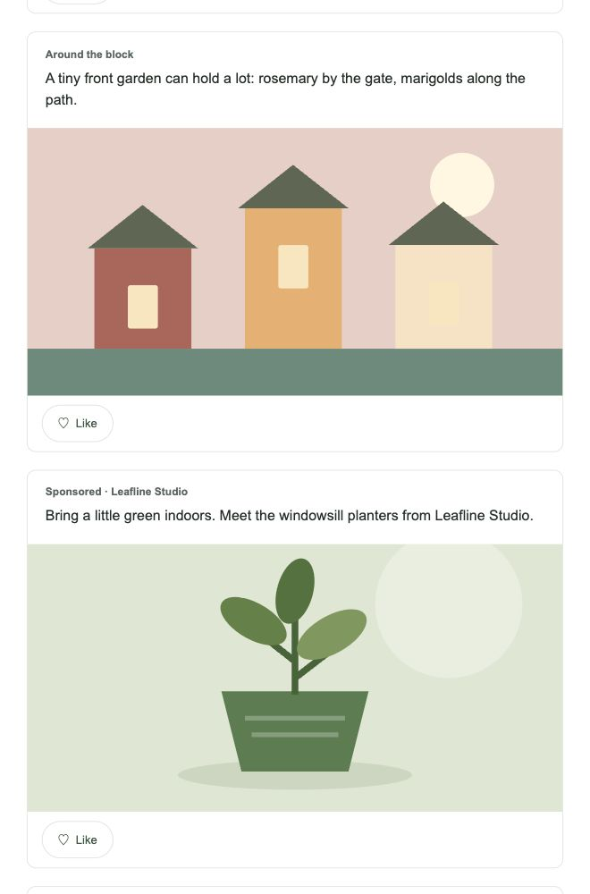

# Decipher social-feed ad testing

[Try the native survey](https://sw2.decipherinc.com/survey/selfserve/57d/2610180)

Five feeds of 30 posts, each with six sponsored ads interspersed among 24 organic posts. Participants scroll and Like posts, or double-click/double-tap an image. Likes can be undone; zero likes is valid. Native Decipher fields store the assigned offers, Likes and qualifying visible time in milliseconds.



All copy and SVG illustrations are original synthetic content. Aster Trail, Kettle & Kind and Leafline Studio are fictional example campaign labels. No personal posts, external image requests, comments, social-proof counters or marketing shell are included.

## Use in Decipher

Upload [`social-design.dat`](social-design.dat) as a **root/system file**, then upload or paste [`survey.xml`](survey.xml) into a testing survey. Both are required. Assets are embedded in XML. The demo remains in testing mode.

An automatic initialization submission saves assignment before feed one. Each feed has neutral Continue and uses the native survey submission. Keep one feed per page. Do not change an experiment's design or schema during data collection.

To regenerate:

```sh
python3 build.py
python3 build-template.py
node tests/timing.cjs
```

`config.json` controls feeds, items and versions: defaults 5 × 30 and eight versions. Supported generator ranges are 1–12 feeds, 1–60 items and 1–99 versions; changed configurations need native verification. There is one sponsored position in each group of up to five items. More than 30 organic positions repeats copy levels.

## Design and native identifiers

The genuine tab-delimited `.dat` contains 1,200 version/task/concept records. The server loads it from `gv.survey.path` during `exec when="init"`. Every copy/image combination and placement comes from this file; the browser does no offer randomization. This reproducible synthetic design is not an optimized conjoint or balanced allocation design.

| Design column | Meaning / native field for feed 2, item 7 |
| --- | --- |
| Version | Assigned `DesignVersion` (1–8) |
| Task | Feed number / `Offer2r7task` |
| Concept | Display position, 1–30 / row `r7` |
| Copy | Copy resource level, organic 1–30 or ad 31–42 / `Offer2r7copy` |
| Image | Original image level, organic 1–10 or ad 11–16 / `Offer2r7image` |
| Order | Explicit display order / `Offer2r7order` |
| Item | Stable feed/position ID, 1–150 / `Offer2r7item` |
| Kind | 0 organic, 1 sponsored / `Offer2r7kind` |
| Creative | Ad combination ID: `10000 + Copy*100 + Image`; 0 organic / `Offer2r7creative` |
| Campaign | 1 Aster Trail, 2 Kettle & Kind, 3 Leafline Studio; 0 organic / `Offer2r7campaign` |
| Context | Feed context ID, 1–5 / `Offer2r7context` |

There are 12 ad copy levels and two compatible image levels per campaign, producing 24 distinct ad creatives. All occur in the design. Each version/task selects six and varies their positions. Organic topics include food, outdoors, gardening, reading, art, neighborhood walks and cycling.

Use `(DesignRevision, DesignVersion, Task, Item)` to identify an assigned offer, and `(DesignRevision, DesignVersion, Context)` to identify its complete feed context. This revision writes `DesignRevision=2`; earlier revision-1 records use a different design and exposure definition. `SessionKey` is an anonymous same-response cache key, not a person identifier.

## Likes and qualifying visible time

`Feed2r7` is a native single-select answer:

| Export code | Meaning |
| --- | --- |
| 1 | Not liked; no qualifying visible time observed |
| 2 | Not liked; positive qualifying visible time observed |
| 3 | Currently liked, independently of time |
| Missing | Feed not submitted; never treat as zero likes |

Unlike returns to 1 or 2 according to measured time. A Like does **not** manufacture exposure time. Generated radio HTML values are zero-based; native export codes are 1/2/3.

`Time2r7ms` and `Time2r7state` are native **number-question cells**, not a JSON payload or text log. Decipher's JSON response API serializes their numeric values as strings; the questionnaire/export schema remains numeric.

The exact timing rule is:

1. The card must intersect the viewport, as reported by `IntersectionObserver`, and the document must be visible and focused.
2. Compute the card's rectangle intersection with the viewport, including horizontal clipping. Its area must be at least **50% of `min(card width, viewport width) × min(card height, viewport height)`**. Thus a tall card can qualify while only its viewport-sized portion is visible.
3. Sample with `requestAnimationFrame` and monotonic `performance.now()`. Add elapsed milliseconds only when both adjacent samples qualify and their gap is at most 250 ms. Boundary frames are conservatively omitted. A longer qualifying gap adds no time and marks the item as an incomplete lower bound.
4. Accumulate across separate visits to the same item. Pause on loss of focus, hidden document, viewport exit and navigation. Flush on Continue, native form submission, page hide and before unload. Floor the cumulative total once when writing integer milliseconds.

| `Time…state` | `Time…ms` | Interpretation |
| --- | --- | --- |
| 0 | -1 | Timing has not initialized; uninstrumented/unobserved |
| 1 | 0 | Instrumented, no qualifying time measured |
| 2 | ≥1 | Positive qualifying time measured |
| 3 | ≥0 | Incomplete lower bound: a long qualifying sampling gap, lost cache on reload, or unavailable storage |
| 4 | -1 | Required timing/browser APIs unavailable |
| Missing | Missing | No submitted measurement for this feed |

Zero milliseconds means no **qualifying** exposure measured, not proof the item was never partly displayed. State 3 is not a complete zero even when its value is zero. Geometry, focus and visibility record a display opportunity, **not attention, reading, ad recall or viewability certification**. Basic intersection checks cannot establish that another window, overlay or CSS opacity did not obscure content.

The same-tab `sessionStorage` cache saves Likes and cumulative timing every 250 ms and at lifecycle boundaries. A reload starts a fresh monotonic baseline, so elapsed reload/background time is not added. Native submissions persist completed feeds. There is no cross-device/closed-tab recovery guarantee; abrupt process termination can lose the last unsaved interval. A missing cache on a detected reload is explicitly marked incomplete. Continue locks before invoking the native button once; failed requests require reload rather than automatic retries.

Like buttons support keyboard activation and `aria-pressed`. A button's second click in the same multi-click sequence is ignored; distinct keyboard activations can toggle rapidly. Image double-clicks and paired touch taps share a 420 ms duplicate guard. Touch pairs must be within 340 ms and 25 pixels; canceled pointers clear the pair.

## Questra reusable template

Import [`questra-template.json`](questra-template.json) in Fine tuning. It has one shared base containing CSS/JS, the timing engine, resources, server-side design loader, persistent assignment and initialization. The reusable `SocialFeed` component owns offer metadata, numeric timing fields, the Like matrix and its page break. Its only input is `task`, a required string enum `"1"`–`"5"`.

Render each task once, in order, in the `main` slot; for example `SocialFeed` with `{"task":"1"}`. Upload the bundled `.dat` as a system file before compilation. Rendering tasks 1–5 reproduces `survey.xml` byte-for-byte with one shared CSS/JS pair; the bundled design bytes/hash match. The export passes Questra's transfer schema and actual component renderer, including invalid/missing task rejection. Regenerate for different counts or designs.

## Verification and limits

Native checks covered all five feeds, multiple and zero likes, keyboard undo/rapid toggles, button/image double-clicks, reload persistence, scroll exit/re-entry, focus pause, final timing flush and completion reload. A second completed response verified zero likes across all five feeds. The mixed-like completed response matched all 150 Like states, 1,350 offer metadata cells and 300 numeric timing/quality cells. Focus loss and offscreen intervals left their totals unchanged. A 361 px card accrued time in a 160 px-high viewport. The 390 px mobile layout had no horizontal overflow. Native XML and `.dat` exact readback matched local source.

Ten deterministic tests cover partial/tall/horizontal intersections, zero-size/offscreen cards, repeated samples, disjoint visits, pause/re-entry, reload baselines, long gaps and timing states. Run `node tests/timing.cjs`.

A real background-tab transition remains a manual check: the automation browser reports owned tabs as visible/focused. The visibility gate is implemented; live focus and scroll pauses were verified. Physical touch gestures, Safari/Firefox, screen readers, blocked-storage recovery and network failures remain unverified. The public folder contains no credentials, response exports or private QA logs.

Implementation references: Forsta's [DCM design-file loading](https://forstasurveys.zendesk.com/hc/en-us/articles/4409469905307-Creating-a-Discrete-Choice-Model-DCM-Question), [single-select XML](https://forstasurveys.zendesk.com/hc/en-us/articles/4409476975899-Single-Select-Question-XML) and [style system](https://forstasurveys.zendesk.com/hc/en-us/articles/4409461374491-XML-Style-System); MDN's [Intersection Observer](https://developer.mozilla.org/en-US/docs/Web/API/Intersection_Observer_API), [Page Visibility](https://developer.mozilla.org/en-US/docs/Web/API/Page_Visibility_API) and [monotonic performance clock](https://developer.mozilla.org/en-US/docs/Web/API/Performance/now).
