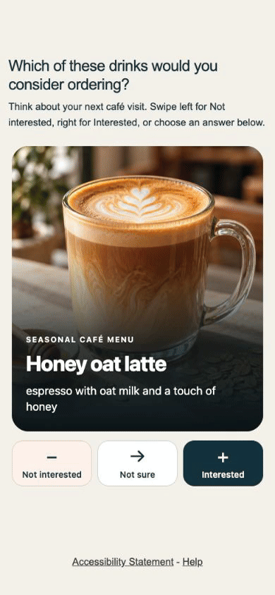
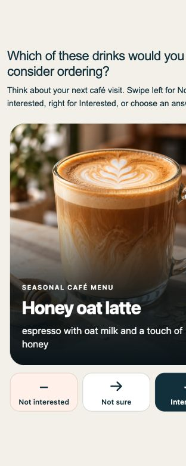

# Pushing the Limits of Decipher: photo swipe cards

A working Decipher survey with full-image café drink cards, a dark bottom fade, and readable title/ingredient overlays. Swipe left for **Not interested**, right for **Interested**, or select **Not sure**. The same answers are available through large buttons and keyboard controls.

[Try the working demo](https://sw2.decipherinc.com/survey/selfserve/57d/2610207) · [Watch/download the MP4](media/demo.mp4) · [Questra fine-tuning template](questra-template.json)





## Use in Decipher

1. Upload the four JPEGs in [`assets/`](assets/) to the survey's **static/public files**, preserving the filenames.
2. Paste [`survey.xml`](survey.xml) into a dedicated testing survey.
3. Preview and verify the question, all four images, answer codes and completion before adapting it to a study.

The survey and template embed the shared Questra page styling and official logo. No external image hosting is required. Photo references use Decipher's `[rel filename.jpg]` syntax. The JPEGs total less than 1 MB and are preloaded when the question enhances. A missing image leaves a dark, readable card; it never blocks an answer. Native matrix fallback retains the full drink text if JavaScript does not enhance the question.

## Answer model and controls

| Column | Saved export code | Meaning |
| --- | ---: | --- |
| c1 | 1 | Not interested |
| c2 | 2 | Not sure |
| c3 | 3 | Interested |

Each drink is a native required radio-matrix row. Not sure is an explicit answer, not a missing response. DOM radio values are zero-based; exports use the codes above. The final answer triggers the existing guarded native Continue flow. The component does not add an independent answer store, skip native validation or show a review screen.

On a focused card, Left Arrow chooses Not interested, Right Arrow chooses Interested, and S chooses Not sure. Vertical/ambiguous or small drags do not choose an answer. Reduced-motion styles suppress card transforms. Answer buttons have at least 64px height, and the compact phone card height leaves room for the question and controls. Long text can expand the card rather than being clipped.

## Reuse with Questra

Import [`questra-template.json`](questra-template.json) in Fine tuning. Its base owns the shared styles, script and footer. Its `SwipeCards` component takes a native `label`, a plain-text `title`, plain-text `instructions`, and `rows`. Each row now requires `label`, `text`, and `image`:

```json
{
  "label": "QSwipe",
  "title": "Which of these drinks would you consider ordering?",
  "instructions": "Swipe left for Not interested, right for Interested, or choose an answer below.",
  "rows": [
    {
      "label": "r1",
      "text": "Honey oat latte — espresso with oat milk and a touch of honey",
      "image": "honey-oat-latte.jpg"
    }
  ]
}
```

The four JPEGs are bundled as public files with SHA-256 hashes. Upload them before previewing. Additional images must likewise be uploaded as survey-owned static files. Use a simple filename for `image`, never markup or a path. Keep text plain. Use one to twenty uniquely labelled rows and preserve columns c1/c2/c3. Do not add randomization, conditional rows or other interactive widgets without separate verification.

## Images and reproduction

The four original unbranded drink photographs were generated with the built-in image generator. [`assets/manifest.json`](assets/manifest.json) records the subjects, shared prompt constraints, processing and hashes. Only JPEG conversion and resizing were applied; the fade and all copy are real HTML/CSS. Images are decorative to assistive technology because the question, card title and ingredients convey the concept.

The current MP4 is an actual recording of the hosted Decipher survey at a 390×844 CSS-pixel mobile viewport. It shows Interested, Not interested and Not sure selections, leaving the fourth card visible. It is silent H.264/yuv420p, 30fps, with fast-start enabled. The GIF is 12fps. `screenshot.jpg` is the current mobile survey; [`media/desktop.jpg`](media/desktop.jpg) shows the desktop layout. Neither recording contains account/browser chrome or respondent data.

## Verification — October 21, 2026 photo revision

- All four static JPEG uploads matched their local SHA-256 hashes; survey XML matched exact native readback.
- Hosted layout checked at 312×675, 390×844 and 1440×900 CSS pixels with loaded images and no horizontal overflow. The answer controls fit the two phone viewports.
- Mobile completed all four choices and reached Decipher's Survey Completed page. The first three native DOM values were 2/0/1 (Interested/Not interested/Not sure); the final choice was Interested.
- Native desktop right drag advanced to the next card. Buttons and keyboard alternatives remain in the component. Shared build/idempotence and JavaScript syntax checks passed.
- Physical phone touch, screen readers, Safari/Firefox and a new exported-response comparison remain unverified for this visual revision. Earlier plain-text versions had wider gesture/export verification; those checks are not presented as fresh photo-revision results.

The hosted demo remains a testing survey. These examples illustrate respondent interactions; imagery and presentation can affect responses, and this is not a claim of improved research validity.
